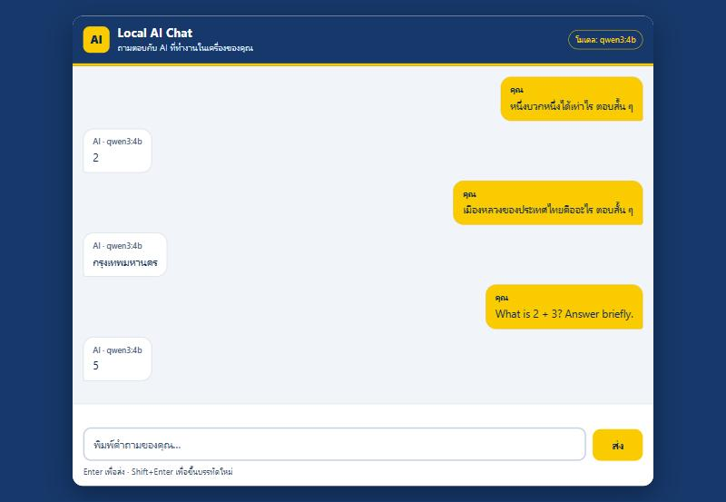

# BC-LocalAI

ASP.NET Core application targeting .NET 10. It serves a Chat web page (FE-001) at `/` and the backend exposes `POST /api/chat`,
answered by a local Ollama model (`qwen3:4b`) through `OllamaAIService` (BE-002).
`MockAIService` (BE-001) is kept for automated tests, so `dotnet test` does not need Ollama.

> **Known limitations (read before merging / deploying):** answers longer than 256 tokens return `502 AI_INVALID_RESPONSE`;
> Ollama answers one request at a time, so many simultaneous users queue and can receive `504 AI_TIMEOUT`; there is no
> authentication, rate limit, conversation history or streaming. Details and measurements: [docs/KNOWN-LIMITATIONS.md](docs/KNOWN-LIMITATIONS.md).

## Requirements

- .NET 10 SDK
- Ollama (on the same machine, loopback only) with the `qwen3:4b` model for running the API; not needed for `dotnet build` / `dotnet test`. Installation: [docs/ai/ollama-setup.md](docs/ai/ollama-setup.md)

## Run locally

```powershell
dotnet run --project .\BC-LocalAI\BC-LocalAI.csproj --launch-profile http
```

Open <http://localhost:5290> in a browser: this is the Chat page.

## Chat web page (FE-001)

Type a question and press **Enter** (or the **ส่ง** button) to send it; **Shift+Enter** starts a new line. The answer appears
with the model name. While the AI is working a "กำลังประมวลผล" bubble is shown and the send button is disabled, so a question
cannot be sent twice. The page works on desktop and on phones, and everything can be done with the keyboard
(Tab reaches the message area, the input and the button; the arrow keys scroll the message area).



| Situation | Text shown to the user |
|-----------|------------------------|
| Empty message (not sent) / `INVALID_MESSAGE` | กรุณาพิมพ์ข้อความก่อนส่ง |
| `AI_UNAVAILABLE` | ไม่สามารถเชื่อมต่อ AI ได้ กรุณาตรวจว่า Ollama เปิดอยู่ |
| `AI_TIMEOUT` | AI ใช้เวลาตอบนานเกินไป กรุณาลองใหม่ |
| `AI_PROVIDER_ERROR` | AI เกิดข้อผิดพลาด กรุณาลองใหม่ |
| `AI_INVALID_RESPONSE`, or a successful answer where `response` or `model` is missing, empty or not a string | ได้รับคำตอบที่ไม่สมบูรณ์ กรุณาลองใหม่ |
| `INTERNAL_ERROR` or anything unknown | ระบบเกิดข้อผิดพลาด กรุณาลองใหม่ |
| The server cannot be reached at all | ไม่สามารถเชื่อมต่อเซิร์ฟเวอร์ได้ กรุณาตรวจการเชื่อมต่อแล้วลองใหม่ |

After an error the question is put back in the input so it can be sent again. Exceptions, stack traces and server messages are never shown.

Rules the page follows: it calls only `POST /api/chat` (never Ollama on port 11434); every text is written with `textContent`,
so HTML or script in an answer is shown as plain text; there is no CDN or new dependency; nothing is stored in the browser
(the conversation is kept in memory only and is gone when the page is reloaded). The page sends a Content-Security-Policy
header (`script-src 'self'`, `connect-src 'self'`, ...), which also stops the browser from calling anything but this site.

Files: `BC-LocalAI/Views/Home/Index.cshtml`, `BC-LocalAI/wwwroot/js/chat-core.js` (logic), `chat.js` (page wiring), `css/chat.css`.
Colors come from the BetterCode logo (navy `#16386A`, yellow `#F9CB00`, red `#ED1C24`, white).
Review guide and evidence: [docs/FE-001-REVIEW-CHECKLIST.md](docs/FE-001-REVIEW-CHECKLIST.md), [docs/FE-001-evidence.md](docs/FE-001-evidence.md).

### Tests for the Chat page

```powershell
dotnet test .\BC-LocalAI.slnx                    # includes the page, static-file and security checks
node --test "tests/ui/*.test.mjs"               # logic tests (Node 20+, no packages to install)
```

> **Stop the running app before `dotnet build` or `dotnet test`.** A running `BC-LocalAI.exe` locks the output files and the
> build fails with `MSB3021` / `MSB3027` ("Unable to copy file ... BC-LocalAI.exe"; typically `10 Warning(s), 2 Error(s)`).
> This is not a code problem: press Ctrl+C in the terminal running the app, then build again.

## Build

```powershell
dotnet build .\BC-LocalAI.slnx
```

## Test

```powershell
dotnet test .\BC-LocalAI.slnx
```

## Chat API

Start the application, then send a valid request:

```powershell
$body = @{ message = "สวัสดี AI" } | ConvertTo-Json
Invoke-RestMethod `
  -Method Post `
  -Uri http://localhost:5290/api/chat `
  -ContentType "application/json" `
  -Body $body
```

HTTP 200 response (a real answer from Ollama; for example, asking "หนึ่งบวกหนึ่งได้เท่าไร ตอบสั้น ๆ"):

```json
{
  "response": "2",
  "model": "qwen3:4b"
}
```

An empty, missing or whitespace-only message (or a malformed JSON body) returns HTTP 400:

```powershell
$body = @{ message = "" } | ConvertTo-Json
Invoke-WebRequest `
  -SkipHttpErrorCheck `
  -Method Post `
  -Uri http://localhost:5290/api/chat `
  -ContentType "application/json" `
  -Body $body
```

```json
{
  "error": {
    "code": "INVALID_MESSAGE",
    "message": "Message is required"
  }
}
```

There is no silent fallback to `MockAIService`: if Ollama is not reachable the API returns an error (see below).
No secrets are used. Ollama is reached through loopback only (AI-002 contract): `Ollama:BaseUrl` must be a loopback http/https URL (`127.0.0.1`, `localhost`, `[::1]`); any other host stops the application at startup. Ollama itself must not be exposed to the public internet.

### Ollama configuration

`BC-LocalAI/appsettings.json` (override with environment variables such as `Ollama__BaseUrl`):

```json
{
  "Ollama": {
    "BaseUrl": "http://127.0.0.1:11434",
    "Model": "qwen3:4b",
    "TimeoutSeconds": 180
  }
}
```

`TimeoutSeconds` is 180 by default; AI-002 suggests up to 300 on a machine without a GPU or for the first model load (maximum 600).

The configuration is validated at startup; an invalid value (bad URL, a URL that is not loopback, empty model, timeout outside 1-600) stops the app with a clear error.

### Error contract

All errors use `{ "error": { "code": "...", "message": "..." } }` and never include exceptions, stack traces or provider details.

| Case | HTTP | Code |
|------|------|------|
| Empty / missing message, malformed JSON | 400 | `INVALID_MESSAGE` |
| Cannot connect to Ollama | 503 | `AI_UNAVAILABLE` |
| Ollama timeout | 504 | `AI_TIMEOUT` |
| Ollama returns an HTTP error | 502 | `AI_PROVIDER_ERROR` |
| Malformed / incomplete Ollama response (`done` not true, `done_reason` not `stop`, bad or empty `answer`, wrong model) | 502 | `AI_INVALID_RESPONSE` |
| Unexpected error | 500 | `INTERNAL_ERROR` |

### Known limits

See [docs/KNOWN-LIMITATIONS.md](docs/KNOWN-LIMITATIONS.md) for the full list with measurements. In short:

- Answers longer than 256 tokens (`num_predict`, per the Issue #5 contract) are cut off by Ollama and the API returns
  `502 AI_INVALID_RESPONSE`. Ask for short answers, or raise the limit through a contract change approved by the Tech Lead.
- Ollama handles one request at a time. Under a burst, requests queue and later ones can time out with `504 AI_TIMEOUT`
  (measured on the development laptop: 15 simultaneous 3-sentence answers with a 12 s timeout -> 4 succeeded, 11 got 504,
  and the API recovered immediately).
- No authentication, rate limit, conversation history or streaming.

### Live smoke test (needs Ollama)

```powershell
.\scripts\live-smoke-test.ps1   # exit code 0 = passed, 1 = failed
```

Verification evidence: [`docs/BE-001-evidence.md`](docs/BE-001-evidence.md) (mock API),
[`docs/BE-002-evidence.md`](docs/BE-002-evidence.md) (Ollama integration).

## Review and testing files

| File | Purpose |
|------|---------|
| `docs/REVIEW-CHECKLIST.md` | BE-001 reviewer guide, acceptance criteria table, code review points |
| `docs/BE-001-evidence.md` | BE-001 build, test and API evidence |
| `docs/FE-001-REVIEW-CHECKLIST.md` | FE-001 (Chat page) reviewer guide and acceptance criteria table |
| `docs/FE-001-evidence.md` | FE-001 test results, browser test notes and screenshots (`docs/fe-001/`) |
| `docs/KNOWN-LIMITATIONS.md` | Known limitations of the Ollama integration with measured numbers (read before merging) |
| `docs/BE-002-REVIEW-CHECKLIST.md` | BE-002 (Ollama) reviewer guide and acceptance criteria table |
| `docs/BE-002-evidence.md` | BE-002 build, test, live smoke test and failure-scenario evidence |
| `scripts/live-smoke-test.ps1` | Live check against a real Ollama (Thai, English, calculation, empty message) |
| `docs/api-examples.http` | Ready-to-send request examples (VS Code REST Client, Rider, Visual Studio) |
| `scripts/smoke-test.ps1` | Contract check of 200 and 400 cases against a running API (needs Ollama for the 200 case; works on Windows PowerShell 5.1 and 7+) |

Quick check: start the API, then run `.\scripts\smoke-test.ps1`.

> The `Invoke-WebRequest -SkipHttpErrorCheck` example above needs PowerShell 7+.
> On Windows PowerShell 5.1 use the smoke-test script instead.

## AI runtime (AI-001)

Follow [Ollama installation](docs/ai/ollama-setup.md) and [API guide](docs/ai/ollama-api.md).
PowerShell 7 (`pwsh`) is required for the verified workflow; check `pwsh --version` first.
Install it using the [official PowerShell Windows guide](https://learn.microsoft.com/powershell/scripting/install/installing-powershell-on-windows) if needed.
With Ollama running and `qwen3:4b` downloaded, run from the repository root:

```powershell
pwsh -NoProfile -File .\scripts\test-ollama.ps1
```

For an interactive local chat that displays only the final structured answer:

```powershell
.\scripts\open-chat.cmd
```

The launcher finds PowerShell 7 from `PATH` or the bundled Codex runtime. Type `/bye` to exit.

See [local test evidence](docs/ai/ollama-test-evidence.md) for results and hardware limitations.
Backend integration must follow the validated [Ollama integration contract](docs/ai/ollama-integration-contract.md).

To check the smoke script against a simulated local API without loading a model,
developers with Python 3 and PowerShell 7 can run:

```powershell
python -m unittest discover -s tests -v
```

If the `python` command is unavailable on Windows but the Python Launcher is installed, use:

```powershell
py -3 -m unittest discover -s tests -v
```

Python is only needed for these developer tests, not for running Ollama or the smoke script.

## Chat quality evaluation (AI-003)

The [evaluation dataset](docs/ai/chat-evaluation-cases.json) contains 160 questions:
40 Thai, 40 English, 40 arithmetic, and 40 edge cases. Each case lists its complete
`accepted_answers`; after light normalization (NFKC, whitespace, trailing `.`/`!`, case),
the whole response must equal one of them, so a correct word inside a wrong sentence fails.
Start the Backend and run:

```powershell
pwsh -NoProfile -File .\scripts\test-chat-e2e.ps1
$LASTEXITCODE
```

The evaluator calls only the loopback Backend `POST /api/chat`; it does not query
Ollama directly. Exit 0 means every case passed. Any failed case returns exit 1
and remains in the JSON evidence with the actual Backend body and failure reasons.
See [evaluation results and reproduction steps](docs/ai/chat-evaluation-results.md)
for the measured cold/warm timings, environment, the latest 160/160 result, and limitations.

For a Thai explanation of AI-001 through AI-003, the tools used, file locations,
limitations, and questions for team handoff, read the [AI work handoff guide](docs/ai/ai-001-003-handoff.md).
For a beginner explanation of API/JSON terminology, the request flow, testing,
timing metrics, PowerShell syntax, and Git workflow, start with the [Thai learning guide](docs/ai/ai-001-003-explained.md).

## Performance benchmark (AI-004)

`scripts/benchmark/ollama-benchmark.ps1` (Ollama `/api/generate`) and
`scripts/benchmark/backend-benchmark.ps1` (Backend `/api/chat`) send predefined short, medium and
long prompts at 1, 2, 5 and 10 concurrent requests and write per-request CSV rows plus a JSON
summary (latency percentiles, throughput, success/timeout rate, CPU/RAM/GPU/VRAM). Both need
PowerShell 7 and are loopback only. See the [test plan](docs/performance/benchmark-plan.md),
the [performance report](docs/performance/benchmark-report.md) (preliminary results) and the
[handoff for BE-003/BE-004](docs/performance/benchmark-handoff.md).
