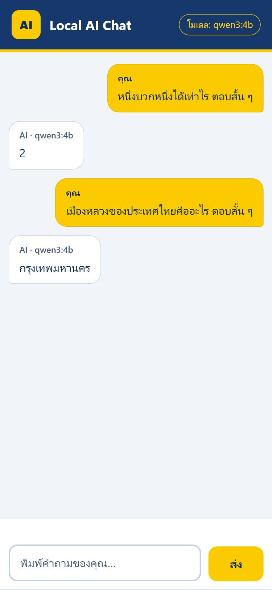
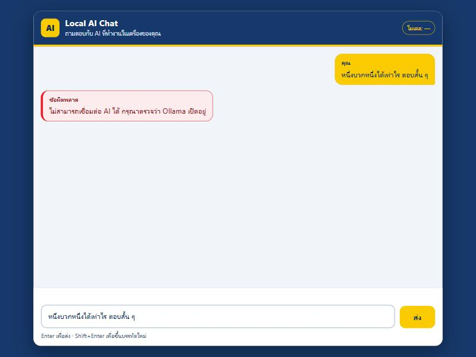

# FE-001 Verification Evidence

- Date: 2026-10-19 (Asia/Bangkok)
- Branch: `watzapon03_Backend` (created from `main` after BE-001, BE-002 and AI-002 were merged)
- Scope: GitHub Issue #10 - Create Local AI Chat Web UI
- Runtime: .NET 10, Ollama with `qwen3:4b`, built-in browser of the Claude desktop app (Chromium)

## 1. What was built

| Item | File |
|------|------|
| Chat page (replaces the template home page, own full-screen layout) | `BC-LocalAI/Views/Home/Index.cshtml` |
| Logic with no DOM (error texts, trimming, key rules, response checks), testable with Node | `BC-LocalAI/wwwroot/js/chat-core.js` |
| Page wiring: send, loading state, double-submit guard, rendering with `textContent` | `BC-LocalAI/wwwroot/js/chat.js` |
| Styles (desktop card, mobile full screen, focus rings, reduced motion) | `BC-LocalAI/wwwroot/css/chat.css` |
| Content-Security-Policy and security headers for the page | `BC-LocalAI/Controllers/HomeController.cs` |
| .NET tests for the page, static files and the security rules of the issue | `BC-LocalAI.Tests/ChatPageTests.cs` |
| Logic tests (Node built-in runner, nothing to install) | `tests/ui/chat-core.test.mjs` |

The page calls only `POST /api/chat`. No new package, CDN or backend change was needed for the API.
The theme uses the colors of the BetterCode logo supplied with the issue: navy `#16386A`, yellow `#F9CB00`, red `#ED1C24`, white.

## 2. Automated tests

```text
dotnet build .\BC-LocalAI.slnx   -> 0 Warning(s), 0 Error(s)
dotnet test  .\BC-LocalAI.slnx   -> Passed! Failed: 0, Passed: 156, Skipped: 0, Total: 156   (21 of them are the new ChatPageTests)
node --test "tests/ui/*.test.mjs" -> tests 13, pass 13, fail 0
```

What they check: the page is the Chat UI and has a labelled input, send button and a `role="log"` message list; the viewport,
breakpoints, `100dvh`, 16 px input text and 48 px touch targets exist; focus rings and `prefers-reduced-motion` exist and no
`outline: none`; the three static files are served with the right type; the page loads only its own two scripts and one style
sheet; the CSP has no `unsafe-inline`, `unsafe-eval` or `*`; no inline script, no `on...=` attribute, no `style=` attribute, no
`javascript:`; no CDN or external host and no mention of Ollama or port 11434 in the page, CSS or JavaScript; the scripts never use
`innerHTML`, `outerHTML`, `insertAdjacentHTML`, `document.write`, `eval`, `localStorage`, `sessionStorage`, `indexedDB`, cookies,
WebSocket or similar; there is exactly one `fetch`, to `/api/chat`; a double-submit guard exists and the button is re-enabled in
a `finally` block; all six required Thai error texts are present. The Node tests check every error code, unknown and hostile
codes (`__proto__`, `constructor`), non-API error bodies, bad 200 bodies, HTML in answers, trimming, Enter / Shift+Enter /
IME rules.

### Mutation check (do the tests catch real bugs?)

16 deliberate bugs were put into a throw-away copy; each one made at least one test fail:
answers written with `innerHTML`; double-submit guard removed; button not re-enabled; browser calling Ollama directly;
conversation saved in `localStorage`; inline `onclick`; CSP header removed; message area not keyboard-focusable; focus outline
removed; viewport meta removed; a required text changed; Shift+Enter sending; Enter during IME composition sending; unknown
code reading `Object.prototype`; message not trimmed; server error text shown to the user.

## 3. Browser tests (real Chromium, real Ollama and real API)

The app was run with Ollama and `qwen3:4b` and driven in a real browser. Results:

| Check | Result |
|-------|--------|
| Page opens, no console error, input focused, model chip shows `โมเดล: —` until the first answer | pass |
| Thai question `หนึ่งบวกหนึ่งได้เท่าไร ตอบสั้น ๆ` | answer `2`, label `AI · qwen3:4b`, chip `โมเดล: qwen3:4b` |
| Thai and English questions in one conversation | `กรุงเทพมหานคร`, `5` (screenshots below) |
| Empty or whitespace-only message | nothing is sent, hint `กรุณาพิมพ์ข้อความก่อนส่ง` shown |
| While waiting | "AI กำลังประมวลผล" bubble, send button disabled, `aria-busy=true` |
| After the answer | button enabled again, input emptied, focus back in the input |
| Enter pressed three times in a row | one user bubble and exactly one `POST /api/chat` |
| Shift+Enter | new line in the input, nothing sent, input grows |
| Multi-line message | line breaks kept in the bubble |
| All 6 error codes, with a server body full of fake stack-trace text | the exact required Thai text, never the server text; question restored to the input; button enabled |
| Proxy HTML error page, empty 404, network failure | generic or network text, no detail |
| **Real API errors**: Ollama down / Ollama never answers (2 s limit) / Ollama HTTP 500 / truncated answer | 503 -> `AI_UNAVAILABLE` text; 504 -> `AI_TIMEOUT` text; 502 -> `AI_PROVIDER_ERROR` text; 502 -> `AI_INVALID_RESPONSE` text |
| **XSS**: answer `<script>...</script><b>..</b><a href="javascript:...">`, HTML as model name, HTML typed by the user | shown as plain text; nothing executed; 0 `img`, `script`, `b`, `a` elements created |
| Browser calling Ollama directly (`fetch` to `127.0.0.1:11434` and `localhost:11434`) | blocked by the CSP (`connect-src`); external site blocked too |
| Injected inline `<script>`, `onerror` attribute, `javascript:` link, external script, inline `style` | all blocked by the CSP, nothing executed |
| Browser storage | `localStorage`, `sessionStorage` and cookies stay empty |
| Mobile 375x812 and 320x568 | no horizontal scroll, whole page does not scroll, input 16 px, send button 76x48 px, input and button always visible |
| 300-character word without spaces, very long answer, 30-line input | wraps inside the bubble, scrolls to the end, input stops at 200 px and scrolls inside |
| Keyboard | Tab order message area -> input -> button; the message area shows a focus ring and scrolls with the arrow keys (120 px for 3 presses) |
| Color contrast (computed from the real colors) | every text pair 7:1 or better (AAA); none below 4.5:1 |

Screenshots: [desktop](fe-001/desktop-conversation.jpg), [mobile](fe-001/mobile-conversation.jpg), [error](fe-001/error-ai-unavailable.jpg).





### Defects found by this testing and fixed

1. The message input was 200 px tall on load (measured while empty). It now uses the one-line height from the stylesheet when empty.
2. The whole page scrolled by 24 px on desktop (the card margin escaped the body). The gap is now padding on `body`.
3. The model chip said `qwen3:4b` before any answer, which could be wrong if another model is configured. It now says `โมเดล: —` until the first answer.
4. The scrolling message area was not reachable with Tab, so a keyboard user could not scroll back to old messages. It is now focusable, has a name and a visible focus ring.
5. The input showed an inner scrollbar for one line of restored text (height missed the 4 px border). The border is now counted.

## 4. Acceptance criteria (Issue #10, section 8)

| Criterion | Evidence |
|-----------|----------|
| User can type and send | section 3 |
| UI calls `POST /api/chat` | one `fetch`, to `/api/chat` (test and network log) |
| Answer and model shown correctly | section 3 |
| Loading state | section 3 |
| No double submit | section 3 (one request for three Enters) |
| Every error contract case | section 3 (6 codes by stub, 4 by the real API) |
| No XSS from text or AI answers | section 3, `textContent` only, CSP |
| Works on mobile | section 3 |
| Works with the keyboard | section 3 |
| Does not call Ollama directly | no mention in the page files, blocked by the CSP |
| `dotnet build` / `dotnet test` pass | section 2 |
| README explains how to use it | `README.md`, section "Chat web page (FE-001)" |
| Screenshot attached | `docs/fe-001/*.jpg` |

## 5. Limits and not verified

- Browser tests were done in Chromium only (the built-in browser). Firefox and Safari were not tested; the code uses only
  standard features (`fetch`, `AbortController`, `requestSubmit`, CSS `dvh`).
- A real phone was not used; phone sizes were emulated (375x812, 320x568). The on-screen keyboard was not tested.
- Screen readers were not run. The page uses a labelled input, a `role="log"` list, `role="status"` for the waiting bubble and
  a named, focusable message area, but real screen-reader behaviour is untested.
- The BE-002 limits apply: answers over 256 tokens return an error and many simultaneous users queue (`docs/KNOWN-LIMITATIONS.md`).
- No conversation history, streaming, Markdown, login or database (out of scope of Issue #10). The conversation is lost on reload.
- The AI answer is shown as plain text, so Markdown or HTML in an answer is not rendered.
- Dependencies of the issue: BE-002 and AI-002 are merged into `main`; written approval of the Ollama contract was not seen.
- Pull request, code review and merge are not done by the developer (owner only merges).
