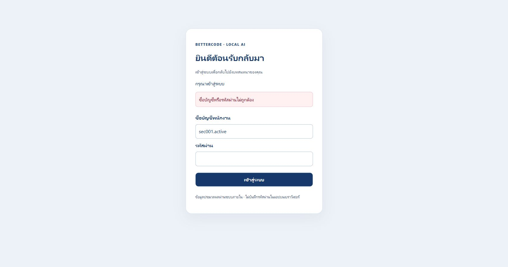
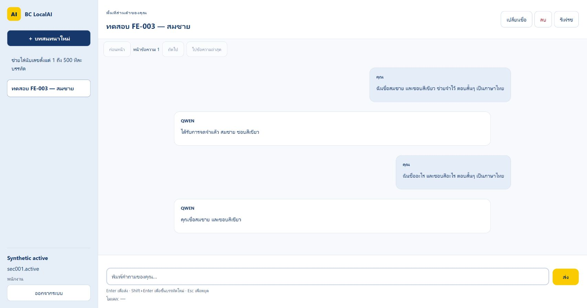
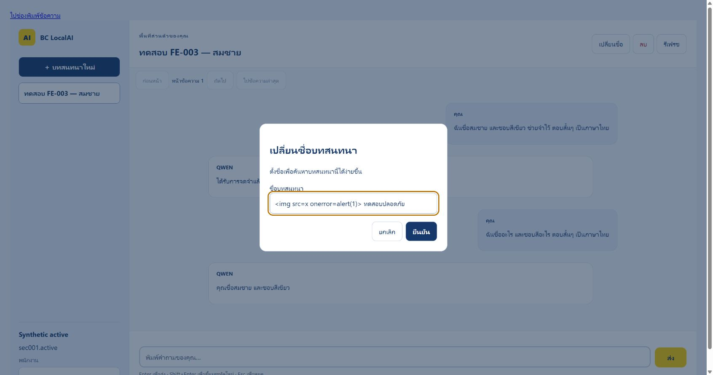
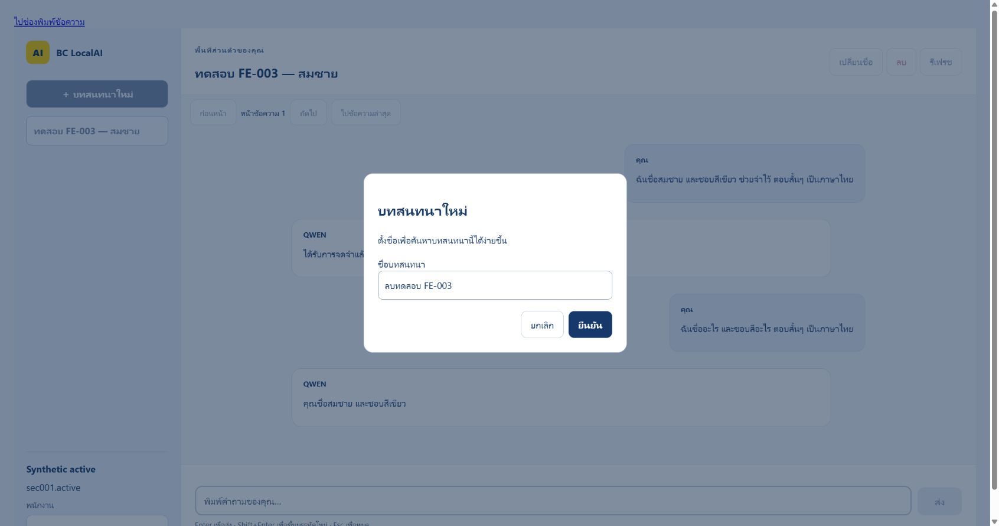
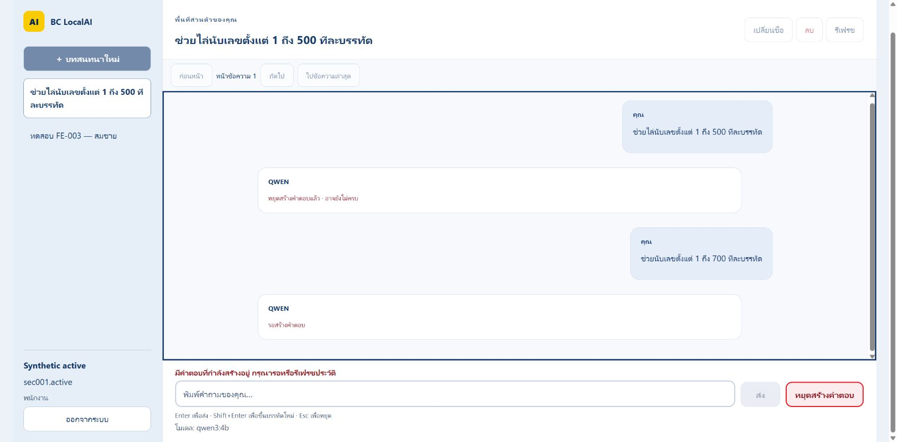
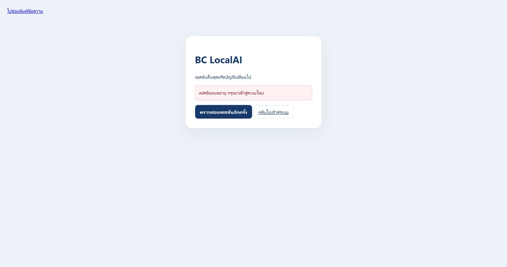
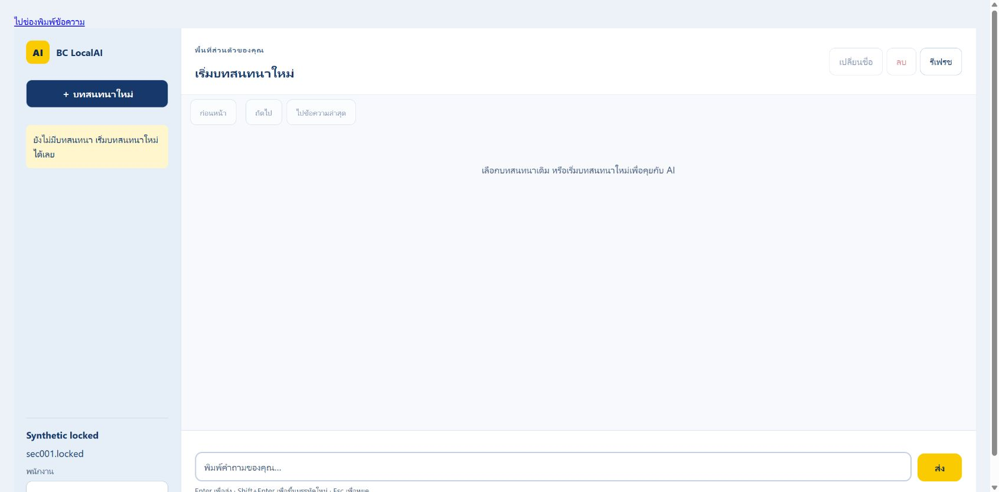
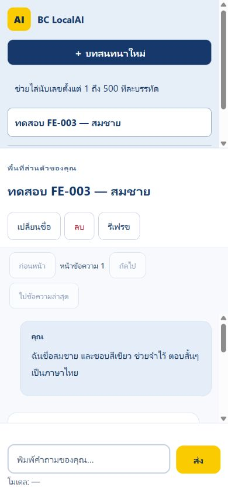
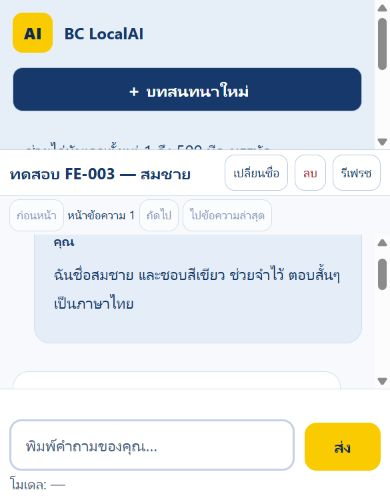

# FE-003 — Real implementation verification

2026-10-21 (Asia/Bangkok) · [FE-003 #24](https://github.com/b3amkawi/BC-LocalAI/issues/24)
· branch `watzapon_FE-003` · main base `d121f50`, merge `c0a1d5e`.

Initial implementation/test evidence is stored in local commit `db98567` on base `d121f50`.
The subsequent user-authorized synchronization integrates `origin/main` at
`38be745b461f59f56c171497e876f35239bcb1f4` (SEC-003 plus AI-006), not merely the earlier observed `d636b4f`.
The only merge conflict was the test baseline: retain the combined floors950/.NET,177/Node,158/Python.
SEC-003 adds the admin tool, its tests and opt-in fixture support; no files under `BC-LocalAI/` changed in the incoming main delta.
The original results below remain historical evidence; see the synchronization verification section for the combined run.

This supersedes the **Mock-only** scope of [the historical preparation report](FE-003-VERIFICATION.md).
See [setup, contracts and recovery](FE-003-REAL-UI.md). No actual employee credentials/company schema were supplied or tested.
All live data below is synthetic and isolated on MySQL3338; Ollama is the actual loopback `qwen3:4b`, not MockAIService.

## Executed checks

| Check | Observed result | Evidence log (ignored local artifacts) |
|---|---|---|
| Release build | 0 warnings /0 errors | `artifacts/fe003-final-build.log` |
| .NET Release Development, after fixes | 863 passed /0 failed /0 skipped | `artifacts/fe003-final-development.log` |
| .NET Release Production, after fixes | 863 passed /0 failed /0 skipped | `artifacts/fe003-final-production.log` |
| Original source rebuilt/retested after isolated mutations | 863 passed /0 failed /0 skipped | `artifacts/fe003-post-mutation-development.log` |
| Production repeated after isolated mutations | 863 passed /0 failed /0 skipped | `artifacts/fe003-post-mutation-production.log` |
| JavaScript (including real transport and DOM-shell races) | 177 passed /0 failed /0 cancelled /0 skipped | `artifacts/fe003-node-final.log` |
| Python regression | 143 passed /0 failures/errors /0 skipped, 227.391s | `artifacts/fe003-python-regression.log` |
| Live HTTPS + MySQL + Ollama verifier, deterministic own pagination data | 38 checks passed | `artifacts/fe003-live-api-final.log` |

Final quality gates: secret scan clean428 files; relative documentation links76 Markdown files pass; minimum test-count gate
863/.NET,177/Node,143/Python passes with0 failures/skips. The scanner initially mistook a variable-bound PowerShell builder entry for
a literal connection-string password. It was rewritten as an explicit builder key (no suppression marker or secret exception),
the builder was checked without printing credentials, and the scan passed. The one-off builder-check harness also had to use
the actual .NET setter rather than PowerShell's dictionary-key adapter; this did not change the app's connection values.
Machine-readable counts, viewport geometry and SHA-256 hashes of the observed logs are in [results.json](fe-003/results.json).

The live verifier covers two distinct real MySQL logins, profile/response-actor agreement, CSRF rejection, wrong-actor precondition,
cross-user GET/PATCH/DELETE404, unchanged owner data, create/rename, real SSE metadata/terminal/Thai answer, exactly one persisted
question/answer pair, advancing cursor pages, stale alias Logout not revoking B, proper Logout/401, independent A session and soft-delete404.
The first verifier run passed36 checks; the final repeat adds2 checks to create/clean its own pagination seed rather than depend on
pre-existing browser data. The final run passed38 checks. Legacy live API callers also compile successfully with0 warnings/errors
(`artifacts/fe003-legacy-live-compile.log`).
It never prints credentials or raw DB errors. Existing BE-007 live-test clients were updated for fresh signed-in CSRF but their
full legacy3320 suite was **not run against a different developer's instance**; the dedicated FE-003 live verifier is the run reported here.

This is functional verification, not a new throughput benchmark. Hardware context from handoff: reference ASUS TUF F16/Core5 210H/16GB/
RTX4050 Laptop6GB; verification machine Acer Predator PHN16-72/i7-14700HX/16GB/RTX4060 Laptop8GB. No reference-hardware latency is inferred.

## Acceptance traceability / deliverables

| Issue acceptance criterion | Implementation / executed proof |
|---|---|
| Login Page | Real `/login` Razor page + `login.js`; browser wrong/correct Login |
| Authentication API integration | Actual BE-005 Login/Logout/me, 38-check live verifier |
| Cookie contract | HTTPS, same-origin fetch, secure server cookie; no new auth mechanism |
| Authentication states | Existing `AuthCore` checking/authenticated/unauthenticated/expired/error; core/DOM tests |
| Protected Views | Server policy/redirect; Development and Production page integration tests |
| Logout | Browser two-tab flow; real API204 then401; stale expected-actor Logout cannot revoke another user |
| Current User | Browser A/B profiles; public DTO whitelist; no Admin read-all |
| Conversation Sidebar | Real per-user list, bounded cursor paging; browser B has no A history |
| New Chat | Browser native dialog + Enter; automatic Unicode-safe title; live create201 |
| Open Conversation | Browser reload/new tab/app restart then open saved conversation |
| Rename | Browser title update and inert HTML payload; live MySQL rename |
| Delete | Browser Cancel/Escape then confirmed soft-delete; API and messages404 afterwards |
| Message History | Real persisted ordered pairs; DTO/status/sequence/cursor validation |
| Resume Chat | Actual qwen3:4b remembered “สมชาย” and “สีเขียว” after reload/open |
| Streaming + Conversation ID | Real SSE conversation/message metadata validation and persisted pair |
| Session Expiration | Browser old cookie after app restart clears all private content; server idle/absolute tests and client idle clearing |
| 401/403 | Server CSRF/identity tests + real API checks; DOM tests clear profile/draft/history |
| No Cross-user Leakage | Server owner404 + expected/actual actor + generation/abort; two browser identities and delayed A→B DOM tests |
| XSS prevention | Inert browser title payload creates zero injected `img`; throwing unsafe-sink DOM tests; CSP |
| No passwords/sensitive data in browser storage | Transport/core/shell tests prohibit storage access and logging; immediate password clearing |
| Automated Tests | .NET, Node, Python, real API checks and three isolated mutation checks |
| Browser Verification | Actual HTTPS Chrome walkthrough and screenshots below |
| Existing Chat no regression | Auth-disabled legacy page, FE-001/002 unit/integration tests included in full runs |
| Review per AGENTS.md | Scope/security/races/error handling/compatibility reviewed; findings and caveats below |

D1 Login, D2 protected profile/Logout, D3 CRUD sidebar, D4 message history, D5 streaming integration, D6 automated tests and D7 this report
are delivered for the approved synthetic-data environment. This is not a claim that production/company-account UAT was completed.

## Browser observations and images

Chrome over trusted `https://localhost:5937`, real MySQL3338 and `qwen3:4b`:

1. Wrong Login: generic Thai invalid-credentials message and password input cleared; then real Login succeeds.
2. Create with Enter; ask in Thai to remember a synthetic name/colour; reload/open and ask again: answer “คุณชื่อสมชาย และชอบสีเขียว”.
3. Rename to ` ทดสอบปลอดภัย`: displayed literally; DOM contains zero injected images.
4. Create disposable conversation; Delete opens confirmation with Cancel focused; Escape preserves it; confirmed delete removes it.
5. Escape during real stream: saved answer reconciles to cancelled/incomplete, not completed; composer becomes available.
6. Application restart invalidates old in-memory sessions: next request shows expired state with profile/messages/draft cleared.
7. Second tab logs out A, logs in synthetic B: B list has no A conversations. Old tab rechecks as B with zero A messages; no stale A content returns.
8. Final desktop1707×898: body height898, send bottom831.38; mobile390×844: body height844, send bottom809.61;
   compact390×500: body height500, send bottom470.42. In each case document scroll width equals viewport width and the composer
   stays in view. Viewport overrides were reset. These are CSS geometry checks, not real-device keyboard UAT.

Browser control had transient disconnects/screenshot timeouts. Those attempted operations were not counted as successful checks;
the browser was recovered and states re-observed. An early mobile capture was rejected after visual inspection and replaced.

## Bugs found and resolved (not hidden reruns)

| Observation | Root cause / correction | Regression protection |
|---|---|---|
| First full .NET run:859 pass /1 failure | Old test expected anonymous HTML even with Auth enabled. Update to assert protected redirect when on and original OK when off. | Both flag states; full863 pass |
| First Production run:860 pass /1 failure | Positive deadline test used artificial50ms wall-clock delay under load. Use already-ready response; retain all negative one-second deadline/stalled/drip tests. Production timeout unchanged. | Focused3 pass, then full863 pass |
| First DOM harness run:167 pass /1 failure | Cross-realm test-object prototype comparison, not application data mismatch. Assert normalized public signal shape. | Full Node177 pass |
| BFCache returned a dead signal/disabled Login | pagehide closed channel/cleared state without reconnect/recheck. Restore channel and verify principal on pageshow. | Both real Login and chat-shell BFCache tests |
| Half an emoji in auto-title | UTF-16 slice could split surrogate pair. Use code-point slicing. | Boundary emoji title test |
| Stop temporarily showed pending | History read raced cancellation commit. Reconcile at most3 delayed reads, no resubmission; truthful unresolved status if still pending. | Settled/unsettled cancellation tests; actual browser cancelled state |
| Guard could miss routing aliases | Routing accepts case/trailing slashes. Normalize scope; never choose owner from the header. | `/API/AUTH/ME/`, stale `/API/AUTH/LOGOUT/` tests/live check |
| Composer outside viewport | Inherited legacy body padding/normal-flow skip link and tall controls in a short viewport. Scope padding reset, out-of-flow accessible skip link and compact short-phone controls. | Actual viewport geometry/screenshot verification |

## Isolated mutation checks

Only copies under ignored `artifacts/fe003-mutants` were changed; actual source was not mutated.

| Deliberate defect | Detection |
|---|---|
| Remove generation invalidation/abort | 2 of36 focused Node tests fail with stale-data assertions; mutant killed |
| Replace sidebar `textContent` with `innerHTML` | 7 of15 DOM tests fail, including unsafe sink/data rendering; mutant killed |
| Disable history mutation CSRF predicate | All5 targeted API cases fail (expected403, actual create/chat/rename/delete success); mutant killed |

Logs: `artifacts/fe003-mutant-state.log`, `artifacts/fe003-mutant-html.log`, `artifacts/fe003-mutant-csrf-rerun.log`.
The first CSRF mutation process was interrupted by the tool reset and had no result; only the assertion-verified rerun above counts.

## Review outcome and remaining boundaries

No known blocking issue remains in the exercised FE-003 flows after the corrections above. Security review checked server-side owner
authorization, principal-bound CSRF, actor preconditions, stale result clearing, HTTPS, cache/CSP, no credential storage/forwarding,
bounded reads/paging/timeouts, no automatic non-idempotent retries and compatibility with the disabled-auth legacy UI.
This is the implementing agent's self-review, not independent team/Leader approval.

Company account/schema mapping, production TLS/proxy/secret configuration, operational retention/purge, deployment and independent
team review remain external release gates. Main's BE-007 policy/implementation is not replaced by the paused experimental BE-007 branch.
No push, PR, merge into main, issue close/comment or deployment was performed. No production data, employee account or other project's branch was changed.

## Synchronization verification — main38be745 (2026-10-21)

User authorized integrating main into the existing FE-003 branch, still without push or merge into main.
Fetched main `38be745b461f59f56c171497e876f35239bcb1f4`; merged SEC-003 and AI-006 locally.
The baseline conflict was resolved by preserving all additional tests:950/.NET,177/Node,158/Python.
No application fix, dependency version change, schema migration or authentication-policy change was needed.

| Check rerun on the combined tree | Result | Local ignored log |
|---|---|---|
| Release solution build | 0 warnings /0 errors | `artifacts/fe003-sync-build.log` |
| Release synthetic-fixture helper build | 0 warnings /0 errors | `artifacts/fe003-sync-fixture-build.log` |
| .NET Development | 950 passed /0 failed /0 skipped | `artifacts/fe003-sync-development.log` |
| .NET Production | 950 passed /0 failed /0 skipped | `artifacts/fe003-sync-production.log` |
| JavaScript | 177 passed /0 failed /0 cancelled /0 skipped | `artifacts/fe003-sync-node.log` |
| Python | 158 passed /0 failures/errors /0 skipped,214.582s | `artifacts/fe003-sync-python.log` |
| Actual HTTPS/MySQL3338/Ollama qwen3:4b | 38 checks passed | `artifacts/fe003-sync-live.log` |

The existing real-browser screenshots and three mutation results above are from the original FE-003 run, not repeated browser
or mutation runs after synchronization. The incoming main delta changed no `BC-LocalAI/` runtime files, and the full automated
UI/API suites plus dedicated real-service verifier were rerun. The separate SEC-003 live admin suite was not rerun; this task
does not provision an admin writer, run account-management commands or modify other developers' fixtures.
Actual-company-account UAT and independent team approval remain external gates. No remote write or production deployment occurred.
