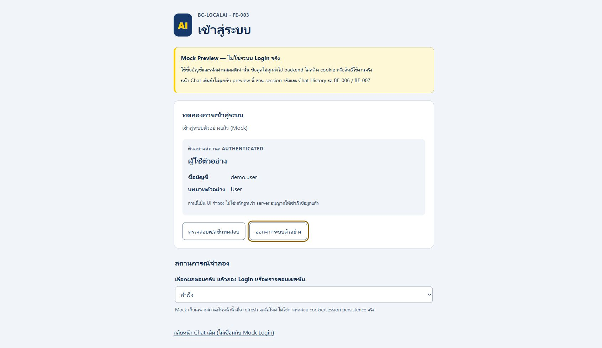
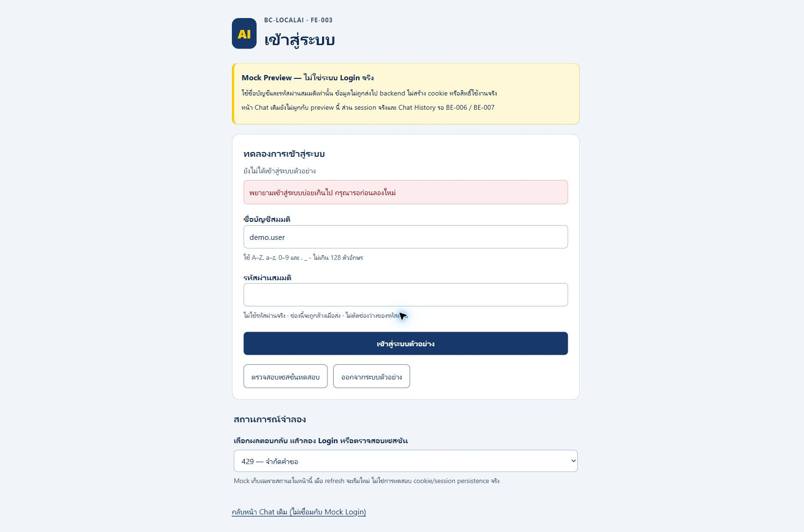

# FE-003 — Mock Login groundwork verification

> Historical Mock-only report. The real integration and current results are in [FE-003 real verification](FE-003-REAL-VERIFICATION.md).

วันที่2026-10-21 · branch `watzapon_FE-003` · base `0cb07ff`
· [ขอบเขตและวิธีรัน](FE-003-PREPARATION.md)

## การ pull main รอบถัดมา

ผู้ใช้สั่ง pull เพิ่มหลังทำ groundwork: เก็บงานใน local commit `2fcdb92` ก่อน pull
`main` = `babbd610f64932065410b753a1d654b81677eed9` (BE-006 / PR35)
conflict มีเฉพาะ `docs/devops/test-baseline.json`: รวม floorของmain652 + FE-003ใหม่12 =664
และคง Node115/Python143 ไม่ทิ้งเทสต์ของฝั่งใด
Authentication ยังfalse และไม่เปลี่ยนเป็น real Login โดยอัตโนมัติ
ภาพด้านล่างเป็นหลักฐานก่อน pull; หลัง pull เปลี่ยนเฉพาะคำเตือนให้ไม่กล่าวว่า BE-006ยังไม่เข้ามา
ผลหลัง pull ที่รันจริง:

| การตรวจ | ผล |
|---|---|
| Release build |0 warnings/0 errors |
| .NET Development |664ผ่าน/0ล้ม/0ข้าม (38s) |
| .NET Production |664ผ่าน/0ล้ม/0ข้าม (1m2s) |
| Node ทั้งชุด |115ผ่าน/0ล้ม/0cancelled/0ข้าม |
| Secret scan / Markdown links |357ไฟล์สะอาด /68 Markdownผ่าน |

Pythonใช้ผล143ผ่านของรอบก่อน pull ด้านล่าง **ไม่ได้รันทั้งชุดใหม่หลัง pull**
ตรวจ diff `0cb07ff..babbd61` แล้วไม่มี Python test/CI helper หรือ AI PowerShell script เปลี่ยน
test-count gateหลังpull ใช้ .NET/Node logใหม่กับ Python logที่เสร็จก่อนpull (664/115/143)
และไม่ได้ปิดบัง failure ที่เคยเกิดก่อนหน้านั้น

## ผลที่รันจริงก่อน pull รอบถัดมา

Windows / .NET10 / Node native test runner / Python3.11 / PowerShell7
ใช้ synthetic user เท่านั้น ไม่ใช้ข้อมูลบริษัทและไม่ต่อฐานข้อมูลจริง
ไม่ใช่ performance benchmark จึงไม่มีการคาดคะเน throughput ตาม hardware อ้างอิง

| คำสั่ง/การตรวจ | ผล |
|---|---|
| `dotnet build BC-LocalAI.Tests/BC-LocalAI.Tests.csproj -c Release --no-restore` | ผ่าน0 warnings/0 errors |
| `dotnet test BC-LocalAI.Tests/BC-LocalAI.Tests.csproj -c Release --no-build` Development |558ผ่าน/0ล้ม/0ข้าม |
| คำสั่งเดียวกัน ตั้ง `ASPNETCORE_ENVIRONMENT=Production` |558ผ่าน/0ล้ม/0ข้าม |
| `node --test "tests/ui/*.test.mjs"` |115ผ่าน/0ล้ม/0ข้าม |
| `python -I -X utf8 -m unittest discover -s tests -p "test_*.py"` รอบแรก |143รัน/1 error จาก timeout ในสคริปต์เดิม; รายละเอียดด้านล่าง |
| Python isolated rerun `-p test_ollama_streaming.py -k a_thinking_marker` |1ผ่าน/0ล้ม ใน11.017s |
| Python full rerun2 |143รัน/1 failure จากสคริปต์เดิมนับคำขอ159/160; รายละเอียดด้านล่าง |
| Python isolated `-p test_chat_e2e_script.py -k expected_word_inside` |1ผ่าน/0ล้ม ใน1.477s |
| Python full rerun3 |143ผ่าน/0ล้ม/0ข้าม ใน237.401s |
| Secret scan / Markdown links |337ไฟล์สะอาด /65 Markdownผ่าน |
| คืน mutation แล้ว rebuild / preview integration ซ้ำ |0 warnings/0 errors /12ผ่าน |

เพิ่มเทสต์66ข้อ: .NET preview integration12 + Node auth core40 + DOM shell14
baseline เพิ่ม .NET546→558, Node23→115 (เดิมรันจริง61) และคง Python143

## Traceability ของเทสต์ใหม่

| ความเสี่ยง/พฤติกรรม | หลักฐาน |
|---|---|
| Production/flag-off/non-loopback/null remote ปิด preview; conventional route bypass ไม่ได้ | `LoginPreviewTests` |
| เปิดเฉพาะ loopback3รูปแบบ, Mock warning, no-store/CSP, scripts200 | `LoginPreviewTests` |
| Chat เดิมไม่โหลด Mock และ authentication ยังปิดตามค่าเริ่มต้น | `ChatRootDoesNotLoadMockAuthenticationAndAuthRemainsDisabled` |
| validation ขอบเขต username/password, Unicode surrogate, exact whitespace/combining forms | `auth-core.test.mjs` |
| request fields/HTTP methods, fresh CSRF, same-origin/no-store, ไม่ retry, sanitize errors | `auth-core.test.mjs` |
| public DTO whitelist, malformed JSON/user/roles, frozen claims | `auth-core.test.mjs` |
| five states, duplicate/overlap, stale completion, clear/navigation, failed Logout ไม่แสดงว่าสำเร็จ | `auth-core.test.mjs` |
| password/profile cleared, focus/aria, XSS literal text,401/403/CSRF/429/503/network UI | `auth-preview.test.mjs` |
| pagehide cancellation, BFCache/visible recheck โดยไม่ใช้ profile snapshot เก่า | `auth-preview.test.mjs` |

DOM tests เป็น VM + fake DOM ที่รัน DOM shell จริง ไม่เรียกว่า full browser E2E
external transport/state เป็น synthetic; ไม่มีการพิสูจน์ real cookie, permission หรือ cross-user database isolation

## Browser verification (Mock เท่านั้น)

เปิด preview บน loopback5936 โดย Authenticationจริงปิด
ตรวจใน Chrome desktop viewport1707px และ responsive390×844px ผ่าน browser viewport override
คืนค่า override หลังทดสอบ ไม่แก้ tab งานเดิมของผู้ใช้

- Desktop: Login ด้วย Enter → profile `demo.user`/User, password cleared และ focusที่Logout
- Logout → formกลับมา, profile/account/usernameเก่าถูกล้าง
-429 → ข้อความภาษาไทยแบบ generic ไม่แสดง raw server error
- Mobile390px:403แสดงข้อความไม่มีสิทธิ์; expired scenario Login แล้ว recheck → expired,
  password/profileถูกล้าง และไม่มี horizontal overflow
- Console warn/error ที่อ่านใน mobile flow เป็นรายการว่าง
- ภาพ mobile capture timeout จาก browser tooling จึงไม่มีภาพ mobile แนบ; ไม่อ้างว่าบันทึกภาพสำเร็จ
- ไม่ได้ทดสอบ mobile device จริง, screen reader หรือทุก browser

## Mutation checks ในสำเนาแยก

คัดลอกเฉพาะ auth JS และ Node tests ไป `artifacts/fe003-verification/mutation/`
ไม่แก้ mutation ใน source จริง; คืนสำเนาจาก source หลังแต่ละรอบ

| จงใจใส่บั๊ก | ผลเทสต์ |
|---|---|
| trim password ก่อนสร้าง POST | core39ผ่าน/1ล้ม exact-password assertion |
| เอา active-operation guard ออก | core39ผ่าน/1ล้ม invocation-count assertion;0cancelled |
| เปลี่ยน display name `textContent` เป็น `innerHTML` | DOM0ผ่าน/14ล้มจาก unsafe HTML sink |
| คืนไฟล์เดิม แล้วรันทั้ง core+DOM |54ผ่าน/0ล้ม/0cancelled |

ปรับเทสต์ overlap ให้ assert invocation count ก่อน await เพื่อไม่ให้ mutation ทำให้รอ deferred promise ค้าง
ช่วงพัฒนาเพิ่มการปฏิเสธ malformed success JSON และล้าง username เดิมเมื่อ identityหาย
มี regression coverage แต่ไม่มีบันทึก pre-fix failure จึงไม่อ้างตัวเลข red→green ของสองจุดนี้

## Python timeout และขอบเขตการสรุป

รอบแรก error `test_a_thinking_marker_in_the_answer_fails_the_run` ใน `test_ollama_streaming`
จาก `subprocess.TimeoutExpired` ค่าระยะเวลารอเป็นลบประมาณ-1010.812s; suite elapsed1457.112s
ผิดปกติเมื่อเทียบกับ isolated rerun11.017s จึงสงสัยเรื่องจังหวะเวลา/สภาพแวดล้อม แต่ยังไม่ยืนยัน root cause
คง log รอบแรกไว้ ไม่แก้หรือเพิ่ม timeout ให้สคริปต์ทีม AI และไม่ลบ/ข้ามเทสต์เพื่อให้ผ่าน

รอบ2 `test_expected_word_inside_wrong_or_extra_sentence_returns_nonzero` ใน `test_chat_e2e_script`
ล้ม assertion159≠160คำขอ (suite234.145s); รันข้อนี้แยกผ่านใน1.477s
ยังไม่ยืนยัน root cause และไม่อ้างว่าการรันซ้ำผ่านจะทำให้ความไม่นิ่งนี้หายไป

Raw logs และสำเนา mutation อยู่ใน ignored `artifacts/fe003-verification/` บนเครื่องนี้
ไม่รวม raw logs ที่มี absolute temp paths/device metadata ลง commit

## Review / ข้อจำกัด

ใช้ coding/testing skill และ code-review ตรวจ correctness, XSS/CSRF, state races, credential handling,
compatibility และ regression จึงแยก preview แบบ offline + Development opt-in แทนการเปิด Loginจริง
ไม่มี dependency/backend/session/schema/Chat/Ollama change
ข้อความข้างต้นหมายถึง patch FE-003 เอง; session/authorization backendของ BE-006 ถูกนำเข้าตามmainที่ผู้ใช้สั่ง pull

**อนุมัติได้เฉพาะ groundwork เพื่อ review ไม่ใช่การอนุมัติเปิด FE-003 จริง**
ยังต้องต่อ BE-006/BE-007, Protected Chat, Sidebar/History/Resume และทดสอบข้อมูลข้ามผู้ใช้บน backendจริง
ไม่มีการเรียก Ollamaจริงในรอบ FE-003 เพราะไม่ได้แก้เส้นทาง Chat; ไม่อ้าง live Chat performance/E2Eใหม่
ไม่มีการ push, PR, issue checkbox, merge หรือ deploy
