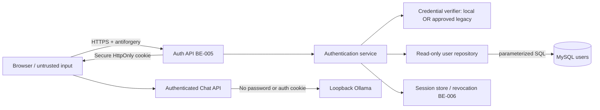

# SEC-001 — Authentication Architecture (Proposed)

วันที่: 2026-10-20 · **สถาปัตยกรรมที่เลือก: บัญชีของ BC-LocalAI บน MySQL (การตัดสินใจของเจ้าของโปรเจกต์ (2026-10-20, ส่งต่อผ่าน watzapon)); ยังไม่ implement ในแอป (BE-005/006); รอ security sign-off**
ข้อเท็จจริง/การเปลี่ยนขอบเขต: [Review report](legacy-auth-review.md)

## 1. ทางเลือกและข้อเสนอ

| ทางเลือก | ข้อดี | ข้อจำกัด/สถานะ |
|---|---|---|
| เชื่อม Legacy ผ่าน adapter | บัญชีบริษัทเดิม ไม่ต้องดูแลบัญชีซ้ำ | **ไม่ใช้** — เจ้าของโปรเจกต์ยืนยันว่าไม่มีระบบ/ข้อมูลบริษัทให้ |
| **บัญชี BC-LocalAI แยกบน MySQL + framework PasswordHasher** | ไม่สร้าง custom crypto; ควบคุม schema/สิทธิ์เองได้ | **เลือกแล้ว** (เจ้าของโปรเจกต์สั่งให้ใช้ MySQL); ต้องมีขั้นตอนดูแลบัญชี (ข้อ 5 ใน review) |
| SSO/Identity Provider ของบริษัท | ลดการอ่าน password hash | ยังไม่ทราบว่ามี provider; ไม่เพิ่มระบบนี้เอง |

ใช้ modular monolith เดิม ไม่สร้าง authentication microservice หรือ JWT แบบทำเอง
`tools/Sec001Fixtures` เป็น offline data generator เท่านั้น ไม่ใช่ adapter ที่ต่อเข้าเว็บ

## 2. Flow และ trust boundaries (conceptual, not live)

ลำดับ Login: validate body + CSRF + rate limit → normalize username → parameterized lookup →
ตรวจ hash ผ่าน approved verifier (dummy hash สำหรับ unknown user) → ตรวจ active/lockout →
สร้าง session ใหม่/rotate CSRF → ส่งเฉพาะ safe user DTO ไม่มี hash/stamp
ผล unknown/wrong/disabled/locked ส่ง generic error เดียวกัน; infrastructure failure แยก 503

ถ้าใช้ Legacy ภายหลังให้แยก `ILegacyPasswordVerifier`/adapter ตาม Source และ synthetic vectors ที่ review แล้ว
ไม่ fallback จาก local verifier ไป Legacy อัตโนมัติ และไม่ถือว่า IdentityV3 อ่าน Custom Hash ได้

## 3. ข้อมูลและสิทธิ์

Schema ใหม่จริง: [schema.sql](../../database/sec001/schema.sql)

| Field | ความหมาย/ข้อจำกัด |
|---|---|
| id | UUID คงที่เป็น NameIdentifier/ChatHistory owner; ห้ามใช้ username เป็นเจ้าของข้อมูล |
| username / normalized_username | username สำหรับแสดงและ unique lookup; เสนอ ASCII 1–128 ตัว อักษร/ตัวเลข/`._-` + uppercase invariant สำหรับ lookup |
| display_name | แสดงผล Unicode; UI ต้อง escape |
| password_hash | IdentityV3 Base64 เท่านั้นใน local fixture; ไม่ส่งให้ Client |
| is_active | default false; ตรวจฝั่ง server |
| role | **User / Admin (ตัดสินแล้ว)**; fixtures ทุกบัญชีเป็น User ไม่แจก Admin อัตโนมัติ |
| security_stamp | เปลี่ยนเมื่อรหัสผ่าน/สถานะ/สิทธิ์เปลี่ยน; ไม่ใช่ secret สำหรับใช้แทน session |
| access_failed_count / lockout_end_utc | เตรียม field; ยังไม่มี login/lockout persistence implementation |
| updated_at_utc | UTC; writer ต้องอัปเดตเอง ไม่ถือว่า trigger ทำให้อัตโนมัติ |

instance พัฒนาแยก `127.0.0.1:3307` database `bc_localai_sec001`; MySQL80 เดิมที่ 3306 ไม่ถูกแก้
admin local ใช้เฉพาะ provisioning; `bc_auth_reader` ได้ SELECT เฉพาะ users ไม่ได้แก้บัญชี
เมื่อเชื่อม DB จริงต้องใช้ TLS และตรวจ certificate/hostname ตาม CA ที่อนุมัติ; ไม่คัดลอก self-signed local defaults หรือปิด certificate validation ไป production
ฐานนี้เป็นของ BC-LocalAI เอง ข้อกำหนด "Company DB read-only" ใน BE-005 จึงหมายถึง: บัญชีที่ใช้ตรวจรหัสผ่าน (`bc_auth_reader`) อ่านอย่างเดียว
ส่วนการเขียน lockout/attempt counters ให้ BE-005/006 สร้างบัญชี writer แยกที่แก้ได้เฉพาะคอลัมน์ที่จำเป็น ไม่ใช้ admin/root ในแอป
BE-006 ต้องมี application session/attempt store พร้อมสิทธิ์เฉพาะของมัน ไม่ใช้ MySQL root
ไม่มี ChatHistory/schema บริษัท migration ในงานนี้

## 4. Session / authorization (รอ approved policy)

- ASP.NET Core Cookie Authentication; `__Host-BC.LocalAI`, Secure, HttpOnly, Path=/, ไม่มี Domain, SameSite=Lax
- ใช้ HTTPS รวม localhost เมื่อเชื่อม Auth จริง; ไม่ลด Secure flag เพื่อให้เว็บ HTTP เดิม Login ได้
- cookie ป้องกันด้วย Data Protection keys นอก web root/จำกัด ACL; วาง key backup/rotation ก่อนใช้หลาย instance
- session ID ใหม่หลัง Login; เก็บ server-side session ID, stable user ID, stamp/version, created/expiry/revoked timestamps
- **ตัดสินแล้ว:** idle 30 นาที, absolute 8 ชั่วโมง, renewal ไม่ขยายเลย absolute
- Logout revoke session ฝั่ง server และ clear cookie; cookie ที่ถูกขโมย/เก่าต้องใช้ซ้ำไม่ได้
- ตรวจ active/role/stamp ทุก protected request ก่อนเรียก AI; DB/session store ล่มต้อง fail closed
- สำหรับ SSE ที่เปิดอยู่: BE-006 ต้องกำหนด bounded revalidation และ cancel upstream เมื่อ revoke/expire; ไม่อ้างว่าป้องกันได้จากเช็กก่อนเปิดอย่างเดียว
- `/api/chat` และ `/api/chat/stream` ต้อง authenticated; auth/CSRF rejection ก่อน SSE headers; คง AI event contract เดิม
- role ไม่ให้สิทธิ์อ่านประวัติคนอื่น — **รวมถึง Admin (ตัดสินแล้ว)**; ทุก conversation route ต้องเช็ก ownership จาก server principal
- Admin ทำได้: สร้าง/ปิด/reset บัญชีผ่านสคริปต์ (ทำใน BE-005/006); ไม่มีหน้าจอหรือ API สำหรับอ่านข้อมูลผู้ใช้อื่น
- กรอบเวลาที่ต้องตัด SSE ที่เปิดอยู่เมื่อ session ถูก revoke และตัวเลข lockout/rate limit: BE-006 เสนอพร้อมเทสต์ ให้ผู้ sign-off (watzapon) อนุมัติ

## 5. Recovery / handoff

local DB ไม่มี autostart service; Start/Stop script ควบคุมเฉพาะ datadir ของ SEC-001
ไม่มี script ลบ/reset DB อัตโนมัติ; Stop เก็บข้อมูลไว้ แยกการล้างข้อมูลเป็นคำสั่งที่ต้องอนุมัติ
ก่อน production ต้องมี backup/restore ทดสอบจริง, key recovery, monitoring/audit และ retention policy
ไม่มีการกำหนด RPO/RTO ในนามบริษัทโดยไม่มี requirements

BE-005 ทำ verifier/repository/Login APIs หลัง design approved; BE-006 ทำ revocation/session/roles/CSRF integration
BE-007 ใช้ stable ID; FE-003 ใช้ safe DTO ไม่เก็บ token/password ใน localStorage
